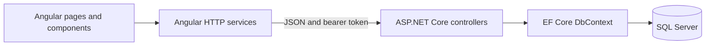

# Task Management System

Organize projects and their tasks in an Angular workspace backed by an ASP.NET Core API.

[](https://dotnet.microsoft.com/) [](https://angular.dev/)

## Demo and screenshots

<!-- TODO: add public live demo URL -->
Hosted demo pending.

Capture these views using demo data:

- a populated project with its task list
  <!-- TODO: add screenshot of a populated project with its task list -->
- the task editor showing assignment and progress fields
  <!-- TODO: add screenshot of the task editor showing assignment and progress fields -->
- a filtered task list with several statuses
  <!-- TODO: add screenshot of a filtered task list with several statuses -->

## Key features

**Projects and tasks**

- Create projects and see their tasks together in the main workspace.
- Add, edit and remove tasks, and update descriptions separately.
- Track task state and search or filter the task list.
- Record assignments as part of the task workflow.
- Remove a project and its related tasks from the workspace.

**Accounts**

- Register a user and sign in before using the project dashboard.

## Architecture



Angular owns page state, filtering and forms. Controllers implement the
application's project and task operations and use EF Core directly. This
keeps the training project small and makes controllers the main place to
look for business and access rules.

## Design decisions

### Project access

- **Problem** · The dashboard needs to show projects for the current user.
- **Solution** · The project list uses the authenticated user ID, and the Angular interceptor attaches the bearer token.
- **Trade-off** · Resource-level authorization needs consistent enforcement across write operations.

### Task data

- **Problem** · The workspace needs tasks alongside each project.
- **Solution** · EF relationships link projects, users and tasks; the project controller assembles the dashboard response.
- **Trade-off** · The list can grow with the number of projects and tasks. Pagination would bound that response.

### Authentication

- **Problem** · Users need a session after signing in.
- **Solution** · The API checks BCrypt password hashes and issues a JWT; the browser stores it and attaches it to requests.
- **Trade-off** · The current flow needs hardening before public deployment, including secret configuration and safer credential and session handling.

## Tech stack

| Area | Technology |
| --- | --- |
| Backend | ASP.NET Core .NET 8, EF Core 9, Swagger UI |
| Frontend | Angular 20.2 and TypeScript |
| Data and caching | SQL Server and EF Core migrations |
| Real-time | HTTP request and response |
| Security | BCrypt and JWT bearer authentication |
| Testing | Angular Karma and Jasmine specs |
| DevOps | Angular CLI and .NET CLI |

## Getting started

Use the .NET 8 SDK or a newer SDK that can target .NET 8, a .NET 8 runtime,
SQL Server and EF Core CLI 9.x. Use Node.js 22.12+ on 22.x or compatible 24.x
with npm. Chrome is needed for the Headless test command.

```bash
git clone https://github.com/FerasAbukweik/fullstack_taskManagment.git
cd fullstack_taskManagment
```

Set `ConnectionStrings__TaskManagment` in the API shell to a development SQL
Server connection for a database you can create or update. The current app
does not read startup settings from a root `.env`; use ASP.NET Core
configuration or an environment variable.

```bash
dotnet ef database update --project TaskManager --startup-project TaskManager
dotnet dev-certs https --trust
ASPNETCORE_ENVIRONMENT=Development dotnet run --project TaskManager --no-launch-profile -- --urls https://localhost:44362
```

The frontend code targets port `44362`. The normal project HTTPS launch
profile uses `7153`, so the explicit URL above keeps both sides aligned.

In a second terminal:

```bash
cd frontend/task-managment
npm ci
npm start
```

| Service | Address |
| --- | --- |
| Angular | [http://localhost:4200](http://localhost:4200) |
| API | [https://localhost:44362](https://localhost:44362) |
| Swagger | [https://localhost:44362/swagger/index.html](https://localhost:44362/swagger/index.html), Development |

Use the signup screen to create a local account. The repository provides no
seeded demo login or Docker Compose configuration.

## Running tests

```bash
cd frontend/task-managment
npm test -- --watch=false --browsers=ChromeHeadless
```

Frontend specs cover component creation for login, signup, dashboard controls
and task dialogs. Several specs currently fail during component setup.
The solution does not include a backend test project.

## Project structure

```text
TaskManager.sln              # Backend solution
TaskManager/
├── Controllers/             # Auth, user, project and task endpoints
├── Migrations/              # SQL schema history
└── DBcontext.cs             # EF Core data access
frontend/task-managment/     # Angular pages, services, guard and interceptor
```

## API overview

Open [Swagger UI](https://localhost:44362/swagger/index.html) in Development.
The API groups cover login, user registration, projects and task operations.

## Known limitations and roadmap

- Move signing configuration out of source and harden credential and token handling.
- Review write endpoints for consistent per-resource authorization before deployment.
- Add backend tests for authentication, ownership and task state changes.
- Add a configurable frontend API base URL and paginate the dashboard response.

## Author

Firas Abukweik · [LinkedIn](https://www.linkedin.com/in/firas-abukweik/) ·
[GitHub](https://github.com/FerasAbukweik) · [Email](mailto:firas.abukweik@gmail.com)
